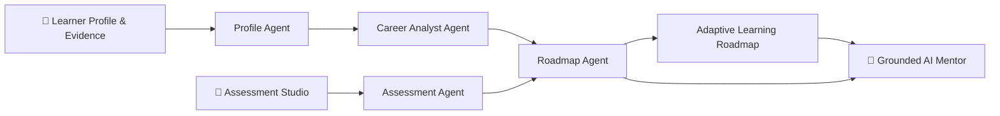

# SkillPath AI — Hackathon Solution

SkillPath AI is an adaptive, multi-agent learning platform that transforms a learner's current competencies and career aspirations into a measurable, explainable learning plan.



---

## 🎯 System Overview & Highlights

- **Live Application URL**: `http://localhost:8000`
- **Project Directory**: `/Users/akileshm/.gemini/antigravity/scratch/skillpath-ai`
- **Zero-Dependency Architecture**: Built with Python 3 standard library (`http.server.ThreadingHTTPServer`, `sqlite3`, `json`) and responsive modern frontend.
- **Audited by Browser Subagent**: Successfully verified across all user journey steps, including adaptive hold/remedial injection and dynamic role switching.


---

## 🧠 Multi-Agent Collaboration Pipeline

| Agent | Responsibility | Implementation Details | Sample Structured Output |
| :--- | :--- | :--- | :--- |
| **Profile Agent** | Extracts skills, projects, certs, and calculates uncertainty based on evidence credibility. | Reads raw profile, evaluates evidence, computes uncertainty ($1 - \text{conf}$), discounts unverified claims. | `"SQL: estimated level 2.0/5, supported by coursework project with SQLite (moderate confidence 50%)"` |
| **Career Analyst Agent** | Compares learner profile with target role requirements. | Calculates transparent gap scores: $\text{gap} = \text{required} - \text{estimated}$. Computes overall readiness %. | `"Missing: JavaScript (4.0 gap), React (3.5 gap), Node.js (3.5 gap). Readiness: 26.4%"` |
| **Assessment Agent** | Evaluates quizzes and practical tasks; flags weak subtopics. | Question-level scoring, subtopic breakdown (e.g. Closures vs Async), updates verified proficiency & confidence. | `"JavaScript: 25%, weak in closures and scope. Trigger priority remediation."` |
| **Roadmap Agent** | Orders skills using topological prerequisite graph and handles safety holds. | Sequences milestones, maps curated resources, injects remedial drills, holds downstream modules (locks React if JS is failing). | `"JavaScript Fundamentals: Priority Remedial Required. React: Held Back pending JS mastery (≥65%)."` |
| **Mentor Agent** | Conversational tutor grounded in real profile, gaps, roadmap, and test results. | Generates grounded responses with code snippets, analogies, and reasons behind locked milestones. | `"React is locked because your quiz showed difficulty with closures. React hooks rely on closures."` |

---

## 🔄 Adaptive Feedback & Demo Scenarios

The platform includes a dedicated **Demo Bar** at the top with 1-click presets for judges:

```mermaid
stateDiagram-v2
    [*] --> InitialState: Load Sample Scenario (Full Stack Dev)
    InitialState --> StrugglingState: Learner scores 25% on JS Quiz
    StrugglingState --> RemedialInjected: Assessment Agent flags weak closures
    RemedialInjected --> ReactLocked: Roadmap Agent locks React & adds remedial drill
    ReactLocked --> MasteryAchieved: Learner passes JS Quiz (100%)
    MasteryAchieved --> ReactUnlocked: React unlocks & readiness jumps to 45.2%
    ReactUnlocked --> RoleSwitched: Learner switches goal to Data Analyst
    RoleSwitched --> DataRoadmap: Gap analysis recalculates; frontend modules removed
```



1. **Preset 1 (`1. Load Sample Scenario`)**:
   - Re-loads the default learner **Alex Chen**, targeting **Full Stack Developer** with Python (3.0), SQL (2.0 unverified), and basic HTML (1.0).
   - Initial Readiness: **26.4%**.
2. **Preset 2 (`2. ⚠️ Fail JS (<50%) [Adaptive Hold]`)**:
   - Simulates struggling on JavaScript closures/functions (score 25%).
   - **Roadmap Adaptation:** Milestone #1 becomes **⚠️ Remedial Practice Required** (Targeted Drill: Functions, Scope & Closures), and React is **🔒 Held Back** with explicit explanation: *"Held back: Prerequisites required: JavaScript Fundamentals (needs mastery ≥65%, currently struggling)."*
3. **Preset 3 (`3. ✅ Pass JS (100%) [Unlock]`)**:
   - Simulates passing JavaScript with a 100% score.
   - **Roadmap Adaptation:** JavaScript is marked verified, React is unlocked, and overall Career Readiness jumps to **45.2%**.
4. **Preset 4 (`4. 🔄 Switch: Data Analyst`)**:
   - Instantly re-calculates gaps for **Data Analyst**.
   - Alex's existing Python and SQL skills immediately boost readiness to **35.0%**.
   - Frontend modules (HTML/CSS, React, Node) are pruned from the roadmap, while **Pandas & Data Wrangling** and **Advanced SQL** move to the top.

---

## 🗄️ Relational Data Model (SQLite)

```
learners(id, name, email, target_role, weekly_hours, bio, certifications, projects, interests)
skills(id, name, category, description, icon)
skill_prerequisites(skill_id, prerequisite_id)
learner_skills(learner_id, skill_id, self_proficiency, verified_proficiency, confidence, evidence, status)
roles(id, title, category, description, icon)
role_skills(role_id, skill_id, required_level, priority, rationale)
resources(id, skill_id, title, type, url, estimated_hours, difficulty, description)
roadmap_items(id, learner_id, skill_id, resource_id, sequence, status, is_remedial, hold_reason, notes)
assessments(id, skill_id, title, passing_score, description)
assessment_questions(id, assessment_id, subtopic, question, code_snippet, options_json, correct_index, explanation)
assessment_results(id, learner_id, skill_id, score, subtopic_scores_json, feedback, passed)
mentor_messages(id, learner_id, sender, message, metadata_json, created_at)
agent_logs(id, agent_name, step, input_json, output_json, explanation, created_at)
```

---

## 💻 How to Run & Verify

1. The server is currently active in the workspace background on port **8000**:
   ```bash
   cd /Users/akileshm/.gemini/antigravity/scratch/skillpath-ai/backend
   python3 server.py 8000
   ```
2. Open your web browser at:
   [http://localhost:8000](http://localhost:8000)
3. Navigate across the tabs:
   - **Dashboard**: High-level overview, readiness meter, active focus, agent activity stream.
   - **Profile & Evidence**: Self-rating vs verified proficiency, confidence bars, uncertainty levels.
   - **Career Match & Gaps**: Role requirements, gap scores, severity, natural language rationale.
   - **Learning Roadmap**: Timeline of milestones, hold warnings, curated learning resources, and progress toggles.
   - **Skill Assessment Studio**: Interactive quizzes with code snippets, subtopic scoring, and diagnostic feedback.
   - **AI Mentor**: Grounded chat assistant with prompt shortcuts.
   - **Agent Inspector**: Flow diagram, real-time audit logs, and JSON payload viewer.
